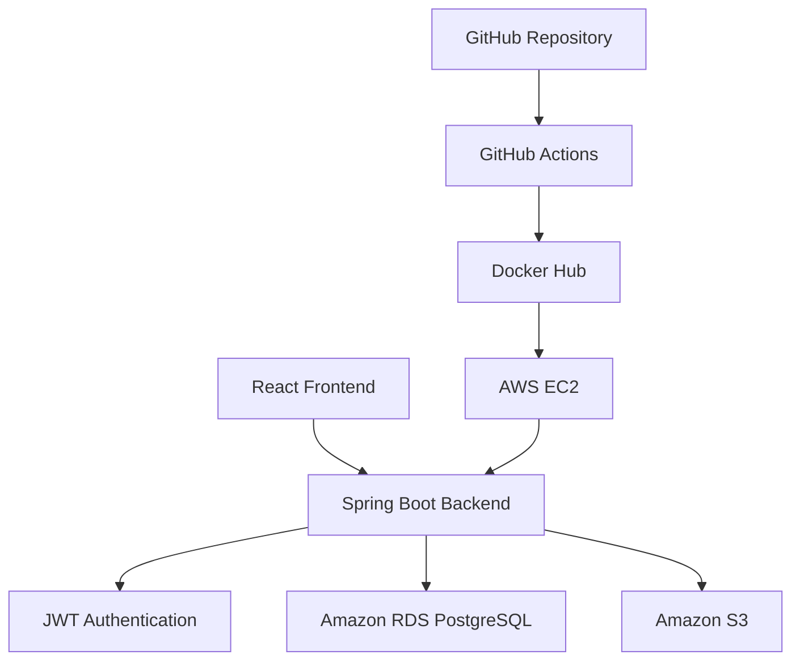

# ☁️ CloudVault – Secure Cloud File Storage Platform

CloudVault is a full-stack cloud-based file storage application that allows users to securely upload, store, manage, and retrieve their files from anywhere. It provides a centralized platform with JWT-based authentication, Amazon S3 storage, and a responsive React interface.

Built using **Spring Boot, React, PostgreSQL, and AWS**, CloudVault demonstrates scalable backend development, cloud infrastructure integration, containerization, and CI/CD automation.

## 🚀 Key Features

- **User Authentication:** Secure user registration and login using JWT-based authentication.
- **File Upload:** Upload files directly to Amazon S3 cloud storage.
- **File Download:** Retrieve and download stored files securely.
- **File Management:** Rename and delete uploaded files.
- **File Search:** Search through stored files for easier accessibility.
- **Dashboard:** Centralized dashboard to manage and view uploaded files.
- **Recent Files:** Dedicated interface for accessing recently managed files.
- **Protected Routes:** Restrict access to authenticated users.
- **RESTful APIs:** Structured backend APIs for communication between frontend and backend.
- **Cloud Deployment:** Containerized application deployed on AWS EC2.

## 🛠️ Tech Stack

| Category | Technologies |
|---|---|
| Frontend | React.js, Vite, JavaScript, CSS |
| Backend | Java, Spring Boot |
| Security | Spring Security, JWT |
| Database | PostgreSQL, Amazon RDS |
| Object Storage | Amazon S3 |
| Containerization | Docker, Docker Compose |
| Cloud Infrastructure | AWS EC2, AWS RDS, AWS S3 |
| CI/CD | GitHub Actions, Docker Hub |
| API Communication | REST APIs, Axios |

## 🏗️ System Architecture



### Application Workflow

1. Users register and authenticate through the React frontend.
2. Spring Security validates requests using JWT authentication.
3. The backend processes file management operations.
4. File objects are stored in Amazon S3.
5. File metadata and user-related information are maintained in PostgreSQL hosted on Amazon RDS.
6. Users can retrieve, download, rename, and delete their files through REST APIs.

## 📂 Project Structure

```text
CloudVault/
│
├── frontend/
│   ├── src/
│   │   ├── components/
│   │   ├── pages/
│   │   ├── services/
│   │   └── ...
│   ├── public/
│   └── package.json
│
├── backend/
│   ├── src/
│   │   └── main/
│   │       ├── java/
│   │       └── resources/
│   ├── Dockerfile
│   └── pom.xml
│
├── docker-compose.yml
└── README.md
```

## ⚙️ Getting Started

### Prerequisites

Make sure you have the following installed:

- Java 21+
- Maven
- Node.js and npm
- Docker and Docker Compose
- PostgreSQL
- AWS account with S3 and RDS configured

### 1. Clone the Repository

```bash
git clone <YOUR_REPOSITORY_URL>
cd CloudVault
```

### 2. Backend Setup

Navigate to the backend directory:

```bash
cd backend
```

Configure the required environment variables:

```env
DB_URL=your_database_url
DB_USERNAME=your_database_username
DB_PASSWORD=your_database_password

JWT_SECRET=your_jwt_secret

AWS_REGION=your_aws_region
AWS_S3_BUCKET=your_bucket_name
```

Build and run the Spring Boot application:

```bash
mvn clean install
mvn spring-boot:run
```

Backend runs on:

`http://localhost:8080`

### 3. Frontend Setup

Navigate to the frontend directory:

```bash
cd frontend
```

Install dependencies:

```bash
npm install
```

Start the development server:

```bash
npm run dev
```

## 🐳 Docker Deployment

CloudVault uses Docker to containerize the backend application, making deployment consistent across environments.

Build the Docker image:

```bash
docker build -t cloudvault .
```

Run the container:

```bash
docker run -p 8080:8080 cloudvault
```

Docker Compose can be used to manage the application's containers and supporting services.

## ☁️ AWS Deployment Architecture

The application uses AWS services for cloud infrastructure:

- **AWS EC2:** Hosts the containerized backend application.
- **Amazon RDS:** Provides managed PostgreSQL database infrastructure.
- **Amazon S3:** Stores uploaded user files and objects.
- **IAM Roles:** Enables secure access to AWS services without hardcoding credentials.

## 🔄 CI/CD Pipeline

CloudVault incorporates an automated deployment workflow using GitHub Actions and Docker Hub.

**Pipeline Workflow:**

1. Developer pushes code to GitHub.
2. GitHub Actions triggers the CI/CD workflow.
3. The application is built and tested.
4. A Docker image is generated.
5. The image is pushed to Docker Hub.
6. AWS EC2 pulls the latest image for deployment.

This approach reduces manual deployment effort and improves deployment consistency.

## 🔐 Security Considerations

- JWT-based authentication for secure API access.
- Spring Security for endpoint protection.
- IAM-based AWS service access.
- Environment variables for sensitive configuration.
- Separation of application data and object storage.

## 🎯 Learning Outcomes

Through CloudVault, the project explores:

- Building scalable REST APIs using Spring Boot.
- Implementing authentication and authorization using JWT.
- Integrating AWS S3 with a Java backend.
- Working with managed PostgreSQL databases using Amazon RDS.
- Containerizing applications using Docker.
- Implementing CI/CD workflows using GitHub Actions.
- Deploying backend applications on AWS EC2.

## 👨‍💻 Author

**Developed as a Full-Stack Cloud Application Project**

If you find this project interesting, consider giving the repository a ⭐!
